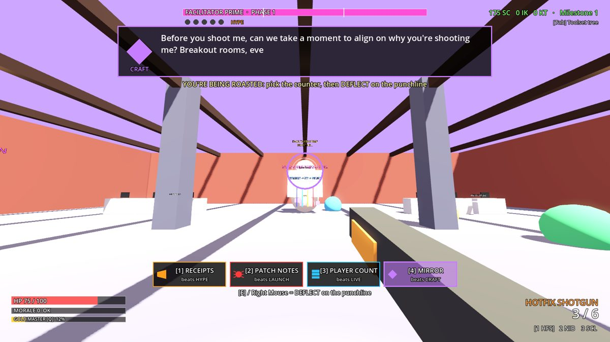
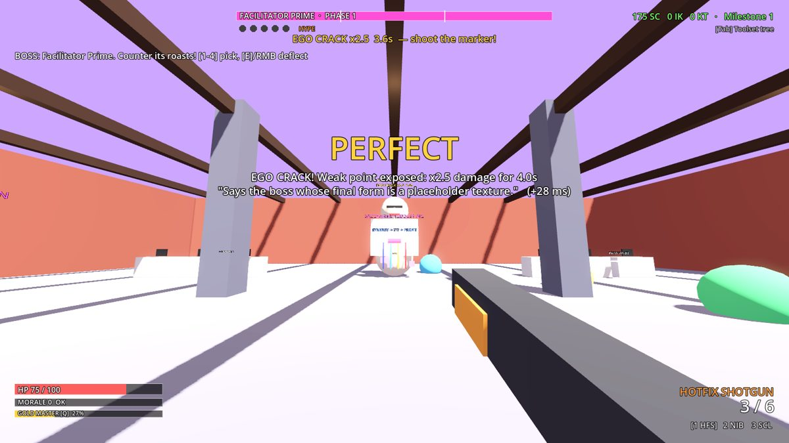
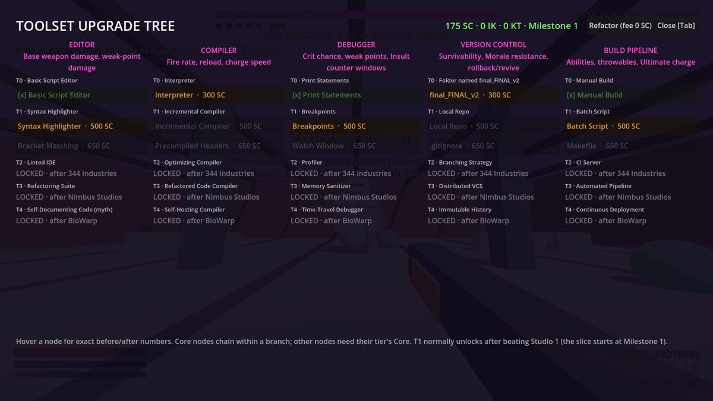

# DAY ONE PATCH — A Code Crusader Story

A satirical 1–4 player co-op FPS set inside a parody of the game industry, built in **Godot 4.4**
and designed to be built mostly with AI ("vibecoded"). This repository currently holds the
**vertical slice** from GDD §10.4: Studio 1's Open-Plan Loft, three enemy types, three weapons,
the data-driven Toolset Upgrade Tree (T0–T1), Facilitator Prime with the full roast
counter/deflect loop, and 2+ player co-op.

| Roast incoming | Ego Crack | Toolset tree |
|---|---|---|
|  |  |  |

All art is placeholder primitives on purpose: the slice proves feel, data, roast timing and netcode first.

## Run it

1. Install [Godot 4.4](https://godotengine.org/download) (standard build, no .NET needed).
2. Open `project.godot` in the editor and press **F5**, or run `godot --path .`.
3. Pick **Play Solo**, or **Host Co-op** on one machine and **Join** with its IP on another (UDP port 24680).

Command-line shortcuts (everything after `--`):

```
godot --path . -- --solo
godot --path . -- --host --name=Alice
godot --path . -- --join=192.168.1.20 --name=Bob
godot --path . -- --solo --start=boss          # skip straight to Facilitator Prime
godot --path . -- --solo --difficulty=hard --assist=assisted_select
```

## Controls

| Action | Keyboard / mouse | Gamepad |
|---|---|---|
| Move / sprint / jump | WASD / Shift / Space | Left stick / L3 / A |
| Fire (hold to charge the Blaster) | Left mouse | RT |
| Weapons | 1–3, mouse wheel, Z/X | Y |
| Reload / interact / revive (hold) | R / F | X / B |
| GOLD MASTER ultimate | Q | LB |
| Comeback Wheel during a roast | 1–4 | D-pad |
| **Deflect** on the punchline | E or right mouse | RB |
| NIB dialogue choice (Agree / Disagree / [Lie]) | 1 / 2 / 3 | D-pad |
| Toolset tree / pause / debug overlay | Tab / Esc / F3 | Back / Start |
| Debug: +1000 credits (debug builds) | F5 | |

## What's in the slice

- **Arena:** The Open-Plan Loft (Saccharine Toddler Inc.): standing-desk pods, beanbags, a break room with Snacks and a coffee machine (−25 Morale; three cups in a minute gives you the jitters), and three Abandoned Design Docs that grant Industry Knowledge. Three waves, then the boss.
- **Enemies:** Hype Intern (swarmer, stress balls, "WE'RE HIRING!" confetti on death), Messaging Consultant (Talking Point Morale damage; its billing meter summons a Partner if it caps), Compliance Officer (armored tank that drops "APPROVAL PENDING" barriers; shoot the red stamp hand to drop them).
- **Weapons:** Hotfix Shotgun (10% chance per kill to buff a nearby enemy with a "regression"), Narrative Integrity Blaster (charged shot freezes a target in a dialogue wheel: Agree = confetti AoE, Disagree = ragdoll into its friends, [Lie] = ally for 8 s), Scope Creep Launcher (spawns a random feature: exploding crafting bench, slowing fishing pond, battle-pass kiosk that distracts enemies, a horse, or a healing seasonal event tree; +10% bloat per consecutive shot).
- **Morale:** Fatigued / Burnt / Crunch State thresholds per GDD §5, including Burnt HUD elements "quitting".
- **Toolset tree:** T0–T1 of all five branches, 15 nodes, data-driven (`data/toolset/*.json`), with the StatResolver math from GDD §7.6 (flat / increased / more buckets, ×6 "more" cap, crit, weak point, insult window, resist). Hover a node for exact before/after numbers. Refactor (respec) fees follow §7.3.
- **Facilitator Prime:** 3 phases (Icebreaker ring, Parking Lot sticky notes that root you, Breakout Rooms walls from phase 2, melts into a puddle in phase 3), phase gates that only open inside damage windows, Hype stacks and the All-Hands Hype Cycle, 10 roast lines, PERFECT/GOOD/DEFLECTED/ROASTED outcomes, Ego Crack weak point, RATIO'D after three PERFECTs, co-op Back Up, difficulty windows, and all three Comeback assist modes.
- **Saves:** versioned JSON (`user://save.json`, schema from GDD §6.2) written on tree purchases and at `MILESTONE_1_SHIPPED`. Each player keeps their own tree and currencies.

> Slice override: `data/slice_config.json` starts players at Milestone 1 so T1 nodes are buyable during the slice. In the full game T1 unlocks after beating Studio 1.

## Multiplayer model

- **Host-authoritative** (GDD §7.8 / §10.3). Single-player is a local host, so the same code path runs everywhere and moving to dedicated servers later is a transport change.
- Owners simulate their own movement (replicated with `MultiplayerSynchronizer`); the host owns HP, Morale, ammo, damage, enemy AI, the boss, tree purchases and currencies. Clients send `srv_*` requests.
- Roasts use host time: clients keep a smoothed clock offset, send `CounterInput{line, counter, deflect_client_time}`, and the host converts it and grants at most min(RTT/2, 150 ms) of lag compensation (`RoastJudge.compensate`).
- A content hash of all JSON data is checked on join, so mismatched builds can't play together.
- Co-op scaling from GDD §10.2: enemy HP ×(1+0.6(n−1)), counts ×(1+0.35(n−1)), boss HP ×(1+0.75(n−1)). Credits from kills are shared within 25 m. Downed players bleed out for 15 s (5 s solo) and can be revived by holding F; bleeding out rolls you back to the last Commit.

### Steam (GodotSteam)

ENet (LAN / direct IP) works out of the box. Steam lobbies, friend invites and Steam Datagram Relay are wired in `scripts/autoload/net.gd` but need the GodotSteam addon, which isn't committed:

1. In the editor, AssetLib → install **GodotSteam GDExtension 4.4** (it includes `SteamMultiplayerPeer`), or download it from <https://godotsteam.com>.
2. Create `steam_appid.txt` in the project root containing `480` (Valve's Spacewar test app) until you have your own App ID, then set `steam_app_id` in `data/slice_config.json`.
3. Run with Steam open. The menu's **Host Steam Lobby** and **Invite Steam Friends** buttons enable themselves when Steam initializes.

The Steam path is written against GodotSteam's 4.x API but **has not been run yet** (it needs a desktop with Steam). ENet co-op is tested automatically.

## Tests

```
tools/run_tests.sh /path/to/godot
```

Runs headless: 113 unit checks (tree data and cost formula, purchase/respec rules, resolver math and caps, roast judging and lag compensation, roast director pacing and shuffle-bag, schema checks, scaling, saves), a solo end-to-end run (waves, all three weapons, tree purchases, a PERFECT counter, the Ego Crack window, phase gates, RATIO'D, milestone save), and a real 2-player host + client session over ENet that checks purchase validation, host-side hit resolution, boss HP scaling and a networked PERFECT counter. GitHub Actions runs the same script on every push and PR.

Screenshots: `xvfb-run godot --path . --rendering-driver opengl3 -- --solo --autotest=shots --shots_dir=/tmp/shots`.

## Project layout

```
data/                 All gameplay content (edit these, not code)
  toolset/*.json      Upgrade tree, one file per branch (GDD 7.5 schema)
  roasts/*.json       Roast banks (GDD 8.5 format)
  weapons/ enemies/ bosses/ levels/ slice_config.json
scripts/core/         Engine-light rules: StatResolver, ToolsetTreeDB, PlayerToolsetState,
                      RoastJudge, RoastDirector, MoraleRules, CoopScaling, SaveGame
scripts/autoload/     Data (content loader), Game (settings, input, save), Net (ENet/Steam, clock sync), CombatBus
scripts/game/         Arena (level, spawners, flow), Player, Enemy, Boss, Combat, projectiles, Scope Creep features, autotest
scripts/ui/           HUD, roast UI, toolset tree, main menu
tests/run_tests.gd    Unit tests
```

## Adding content

- **A roast line:** append to `data/roasts/facilitator_prime.json`. `punch_ms` is when the joke lands, measured from the start of the line. The unit tests validate the schema.
- **A tree node:** add it to the branch file. Effects use the closed op set (`stat_mod`, `grant_tag`, `grant_ability`, `trigger`, `override_rule`) and the stats registry in `StatResolver.STATS`; `ToolsetTreeDB` reports unknown stats, ops or prerequisites at boot.
- **An enemy or wave:** add to `data/enemies/enemies.json` (`ai` is `swarmer`, `caster` or `tank`) and reference it in `data/levels/open_plan_loft.json`.

When exporting, add `data/*.json` to the export preset's non-resource include filter so the content ships in the PCK.

## Not in the slice yet

Group Roasts (3–4 players), Cultural Knowledge buffs, throwables (Makefile's +1 capacity and Precompiled Headers' railgun charge are inert until those weapons exist), T2+ nodes and abilities, VO and audio, real art, the other studios. Satire rule from the GDD: jokes target corporate behavior and public outcomes, never real employees.
